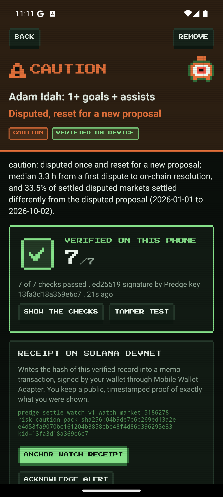
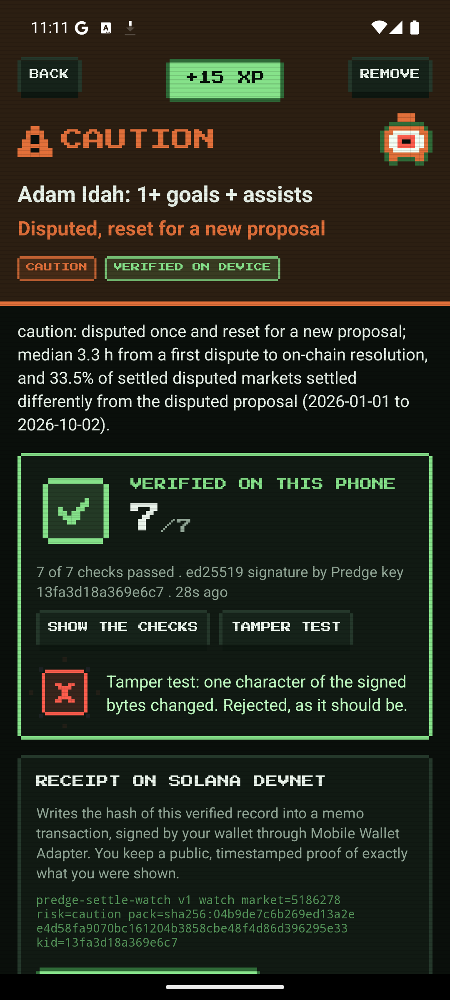
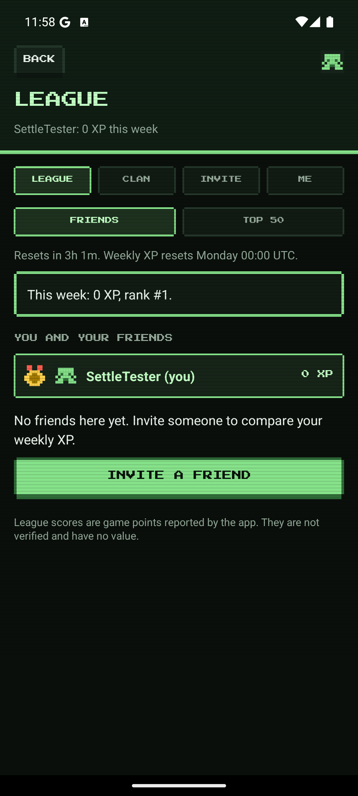
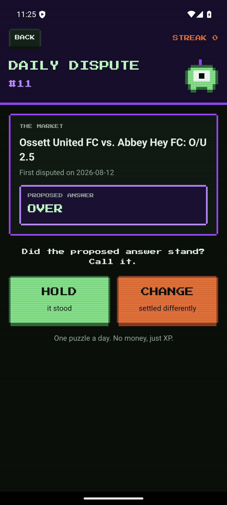
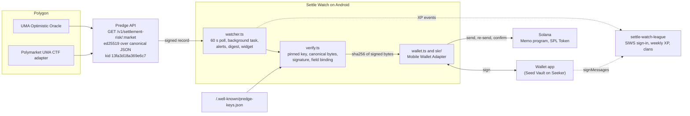

# Settle Watch

**Settlement alerts for Polymarket markets, verified on your phone, with receipts on Solana.**

Settle Watch is a native Android app built by Predge for Solana Mobile's **Clock In** hackathon (October 2026). It watches the markets you pick for UMA disputes, clarifications, token-holder votes and on-chain settlement. Every record is signed by Predge with ed25519, and the phone checks the signature itself before it shows the record as verified. With Mobile Wallet Adapter you can then write a receipt of exactly what you saw to Solana.

| | |
|---|---|
| APK | [Latest release](https://github.com/predgeAI/predge-settle-watch/releases/latest) (Android 7+, arm64) |
| Demo video | [Watch the demo][demo-video] |
| Pitch deck | [settle-watch-pitch-deck.pdf][deck] (release asset) |
| Package | `io.predge.settlewatch` |
| Stack | React Native (Expo 52, prebuild), `@solana/web3.js` 1.99, Mobile Wallet Adapter 2.2.2, tweetnacl |
| License | MIT |

<!-- Change the demo video link here only. Every demo video link in this README uses this one reference. -->
[demo-video]: https://youtu.be/CFtoGIHPZKk
[deck]: https://github.com/predgeAI/predge-settle-watch/releases/latest/download/settle-watch-pitch-deck.pdf

## The problem

From 1 Jan to 2 Oct 2026 there were **3,005 UMA disputes on 2,666 Polymarket markets**. Of the 2,543 disputed markets that settled, **853 (33.5%) settled differently from the disputed proposal**. The median time from first dispute to on-chain resolution was **3.3 h**, so a holder who hears about it late has little time to act.

Source: UMA Optimistic Oracle and Polymarket UMA CTF adapter logs on Polygon, scanned by Predge.

## What it does

| Detail, verified | Tamper test | League | Daily Dispute |
|---|---|---|---|
|  |  |  |  |

Screenshots are from builds 0.3.1 to 0.3.5. The current build places the same screens in four bottom tabs.

### Today
- Today card: every watched market whose status changed in the last 24 h, and how many still need attention.
- Daily clock-in with a streak (one free miss per week), XP and levels. All kept on the phone.
- Watchlist of up to 50 markets. Counters (Caution, Watch, Quiet, Settled) double as filters.
- Market detail: a plain-language status line, **Verified on this phone** with the checks one tap away, **Tamper test**, **Anchor watch receipt**, **Acknowledge alert**, the SKR evidence pack and past receipts.

### Play
- **Daily Dispute**: one real disputed market a day. Call HOLD or CHANGE, then see what happened.
- **Rule Detective**: 19 real rule excerpts. Find the phrases that lead to disputes.
- **Glossary**: 12 collectible cards that unlock as you use the app.
- **League**: weekly XP boards for friends and a global top 50, plus clans. Sign in with your wallet (a signed message, no transaction).
- Weekly recap and badges.

### Discover
- Popular open markets from Polymarket's public gamma API. One tap to watch.
- Add a market by polymarket.com link, slug, numeric id or 0x condition id.

### Me
- Wallet card: connect with Mobile Wallet Adapter, SOL and SKR balances, devnet faucet button.
- Settings: language, daily digest and its hour, receipt network (devnet or mainnet), check now, digest now, test alert, how it works.

### Across the app
- **Home-screen widget** (4x2, resizable): counts per status, the market that needs attention, streak, time of last check.
- **Share card**: a 1080 x 1350 receipt image with the pack hash, the transaction signature and a QR code of the explorer link. The QR encoder is written in this repo and tested against ISO 18004 reference matrices.
- **Receipts**: memo transactions on devnet (default) or mainnet. See [docs/RECEIPTS-AND-SKR.md](docs/RECEIPTS-AND-SKR.md).
- **SKR evidence pack**: pay 1 SKR on mainnet to unlock the full record and local timeline for one market.
- **5 languages**: English, Spanish, Portuguese (Brazil), Simplified Chinese, Korean. The widget follows the app language.
- **Notifications**: one alert per changed market, a daily digest at the hour you choose, and a test alert marked [TEST]. Checks run every 60 s while the app is open and about every 15 min in the background, also after a reboot.
- In-app pixel dialogs instead of system alerts, haptics, reduced-motion support.

## Solana Mobile Stack

**Mobile Wallet Adapter** ([src/wallet.ts](src/wallet.ts), [src/skr/chain.ts](src/skr/chain.ts), [src/league/auth.ts](src/league/auth.ts))
- `authorize`, `reauthorize`, `deauthorize`. An auth token is reused only on the cluster it was issued for.
- No network call inside a wallet session. The app fetches a blockhash first, opens the wallet only to sign, then sends from the app. Android can freeze a wallet in the background before it broadcasts, so this is more reliable.
- `signTransactions`, then app-side send: `landTransaction` re-sends the signed bytes every 2 s (`skipPreflight`, `maxRetries: 0`) until the signature is confirmed or the blockhash expires. If a wallet refuses sign-only, the app falls back to `signAndSendTransactions` with `minContextSlot`.
- The signed transaction is saved before it is sent. If Android kills the app behind the wallet, `resumePending` finishes it on the next start. It never records a receipt the chain does not have.
- `signMessages` over a SIWS-style message (domain, nonce, issued at, expiry) to sign in to the League. No fee.
- Config plugins: `with-activity-config` keeps the activity alive across configuration changes so a wallet session is not dropped; `with-mwa-queries` adds the `solana-wallet` intent query for Android 11+.

**On-chain actions**
- Watch receipt: one Memo program instruction. Devnet by default. Mainnet after a confirmation dialog.
- SKR unlock, mainnet only: an optional `CreateIdempotent` for the treasury's token account, SPL Token `TransferChecked` of exactly 1 SKR (mint `SKRbvo6Gf7GondiT3BbTfuRDPqLWei4j2Qy2NPGZhW3`, 6 decimals) to treasury `8gTLrkxZkL3yewzGBEQhv3Y3C7DzsfMUEZqybvP5Nh8S`, and a memo naming the pack. Instructions are built byte by byte, without the spl-token package.

**App identity**
- MWA identity: name `Settle Watch`, URI `https://predge.io`. `https://predge.io/.well-known/assetlinks.json` is served as `application/json` and binds `io.predge.settlewatch` to the release signing certificate (SHA-256 `07:D3:6A:05:...:EF:36`), so a wallet can check that the app claiming predge.io is the real one.

**dApp Store readiness**
- Release APK signed with a stable upload key kept outside the repo, fixed package name, Digital Asset Links in place, three Android permissions (notifications, boot completed, wake lock). The dApp Store listing has not been submitted yet.

### Verified example transactions

| Network | What | Transaction |
|---|---|---|
| Devnet | Watch receipt, market 5186278, 12 Oct 2026 | [3adw8K21...gsAyFyB](https://explorer.solana.com/tx/3adw8K21VicxJg9Ekxmq3bzRZrDSAZcN5doXvd1g8NYweDBNAfLUaGJcjKfupVLmGQA77v2K7jRpJdGn3gsAyFyB?cluster=devnet) |
| Mainnet | SKR evidence pack unlock, market 5186278, 12 Oct 2026 | [27drBVRJ...oHvcTCvM](https://explorer.solana.com/tx/27drBVRJfdbsdKT9hd36hvntTf528MdJUkscNSzAXQ2199bfsWZkXGZNmjHiLnBuQVZcGFbNHdji3FDfoHvcTCvM) |

Check any receipt yourself: `scripts/verify-receipt.sh <signature> [devnet|mainnet-beta]` prints its memo from a public RPC.

## Architecture



Details in [docs/ARCHITECTURE.md](docs/ARCHITECTURE.md). Security model in [docs/THREAT-MODEL.md](docs/THREAT-MODEL.md).

The Predge API existed before the hackathon and is a dependency. This repository (the Android app, on-device verification, alerts, widget, share card, receipts, SKR payments, League client) and the League backend `settle-watch-league` were built for Clock In.

## Try it in 5 minutes

1. Install the APK from [Releases](https://github.com/predgeAI/predge-settle-watch/releases/latest) on a Seeker or any arm64 Android phone.
2. Install a Mobile Wallet Adapter wallet (Phantom, Solflare, or Seed Vault on Seeker) and set it to devnet.
3. Go through the short intro. Three example markets are added for you. Allow notifications.
4. **Me**: tap **Connect wallet**. Tap **Devnet SOL** if the balance is zero.
5. **Today**: open the Caution market. See **Verified on this phone**, tap **Show the checks**, then **Tamper test**.
6. Tap **Anchor watch receipt**, approve in the wallet, then **Open explorer** or **Share card**.
7. Optional, mainnet: with at least 1 SKR and a little SOL, tap **Unlock with 1 SKR** on the same market.

## Build from source

Requirements: Node 20, JDK 17, Android SDK 35 (build-tools 35.0.0, NDK 26.1.10909125). No Expo account or EAS needed.

```bash
npm ci
npm test                      # 71 offline checks
npx expo prebuild --platform android
cd android
./gradlew assembleRelease -PreactNativeArchitectures=arm64-v8a
# android/app/build/outputs/apk/release/app-release.apk
```

Release signing: set `SETTLEWATCH_UPLOAD_STORE_FILE`, `SETTLEWATCH_UPLOAD_STORE_PASSWORD`, `SETTLEWATCH_UPLOAD_KEY_ALIAS` and `SETTLEWATCH_UPLOAD_KEY_PASSWORD` as Gradle properties, for example in `~/.gradle/gradle.properties`. They are never committed. Without them the build falls back to the debug key, and that APK does not match `assetlinks.json`.

`npm test` runs [scripts/selftest.ts](scripts/selftest.ts): input parsing and lookalike hosts, API shape checks, canonical JSON, streak and XP rules, puzzle data, widget summary, the QR encoder against reference matrices, the share card, SKR instruction bytes and account order, and League ranking.

`npx tsx scripts/verify-live.ts 5186278 4585694 601819` runs the app's own verifier against live signed records and confirms that the tamper test fails.

## Status

- Built for Clock In, October 2026. First commit 5 Oct 2026.
- No users, downloads or revenue are claimed.
- Devnet: watch receipts by default. Mainnet: watch receipts after you switch the network, and every SKR payment.
- League scores are game points reported by the app and capped by the server. They are not verified and carry no value.
- Background checks follow Android's schedule (15 min minimum, may be deferred). There is no push server.
- `risk_level` and `recommendation` are Predge's reading of chain facts, not advice.
- Known limitations: [docs/THREAT-MODEL.md](docs/THREAT-MODEL.md#known-limitations).

## Security

Report issues to hello@predge.io. See [SECURITY.md](SECURITY.md).

## Support

Open source under MIT, maintained by Predge. Donations cover RPC and hosting and buy no service or token: EVM `0x9084f5000E07C7133D6dA5eE4f271AB6D1821144`, Solana `9dxMRRtC7RKZH5rFZpUywjmnQ87H9qHhtW43u5LYmpV`, or [Drips](https://www.drips.network/app/projects/github/predgeAI/predge-settle-watch).
