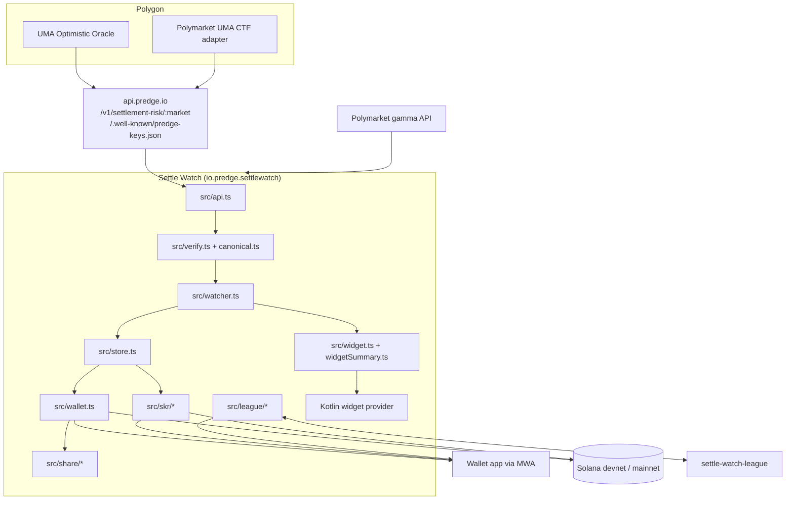

# Architecture

Settle Watch is one React Native app (Expo 52, prebuild, no EAS) with a small native Android part for the widget, plus a separate League backend. The Predge API is an existing dependency.



## Data path

1. **Fetch.** `fetchSettlementRisk` ([src/api.ts](../src/api.ts)) calls `GET https://api.predge.io/v1/settlement-risk/:market` with a 20 s timeout and shape-checks the body (`assertSettlementRisk`).
2. **Verify.** `verifyRecord` ([src/verify.ts](../src/verify.ts)) runs 7 checks: pinned key, key active in `/.well-known/predge-keys.json`, ed25519 algorithm, canonical re-serialization, signature, 11 displayed fields equal the signed payload, and the pack hash `sha256(canonical)`. Details in [THREAT-MODEL.md](THREAT-MODEL.md).
3. **Detect changes.** `snapshotOf` and `describeChanges` ([src/store.ts](../src/store.ts)) compare the new record with the last snapshot: more disputes, sent to a UMA vote, a new clarification, a new `uma_state`, paused or unpaused, settled on chain, and a new `risk_level` when nothing else changed. Each change becomes a timeline line.
4. **Alert.** `pollAll` ([src/watcher.ts](../src/watcher.ts)) sends one notification per changed market on the high-importance `settlement-alerts` channel, marked "Verified on device" or "NOT verified". Then it updates the widget and maybe sends the daily digest.
5. **Store.** Watchlist (max 50), settings, wallet session, receipts, pending transactions and game state live in AsyncStorage and are sanitized on load.

## Polling

- Foreground: every 60 s (`FOREGROUND_POLL_MS`).
- Background: `expo-background-fetch` task `predge-settle-watch-poll`, minimum interval 15 min, `startOnBoot: true`, `stopOnTerminate: false`. The task reads the saved language itself, since it runs without the UI.
- Digest: once per local day, after the chosen hour, only if enabled and onboarded (`maybeSendDigest`). It runs from both paths.
- After a background poll, the result is merged with any adds or removes the UI made in the meantime.

## Solana

| Action | Code | Network | Instructions |
|---|---|---|---|
| Connect, disconnect | `connectWallet`, `disconnectWallet` | receipt network | none (MWA `authorize`, `deauthorize`) |
| Watch receipt | `anchorPack` | devnet default, mainnet optional | Memo |
| SKR unlock | `payForPack` | mainnet | optional ATA `CreateIdempotent`, SPL `TransferChecked`, Memo |
| League sign-in | `signInWithWallet` | none | none (MWA `signMessages`) |
| Devnet faucet | `requestDevnetAirdrop` | devnet | none (RPC `requestAirdrop`, 0.5 SOL) |

Formats, account lists and the send loop are in [RECEIPTS-AND-SKR.md](RECEIPTS-AND-SKR.md).

RPC: one `Connection` per cluster, HTTP only (no websocket subscriptions, so nothing hangs while the wallet is in front), commitment `confirmed`, 12 s timeout per request, retries with backoff for reads (`withRetry`).

## League

- Client: [src/league/](../src/league). Feature flag `LEAGUE_ENABLED`. API base `https://settle-watch-league.vercel.app`.
- Backend: separate repository `settle-watch-league` (TypeScript on Vercel, Redis store).
- Sign-in message (built by the server, signed with `signMessages`):

```
<domain> wants you to sign in with your Solana account:
<wallet>

Sign in to the Settle Watch League. This does not send a transaction and costs nothing.

URI: https://<domain>
Version: 1
Chain ID: mainnet
Nonce: <32 hex>
Issued At: <ISO time>
Expiration Time: <ISO time>
```

- The nonce is fetched before the wallet opens and the signature is sent to `/api/auth/verify` after it closes. No network call happens inside the wallet session.
- XP: every local XP award goes through `onXpAwarded` in [src/game.ts](../src/game.ts). [src/league/reporter.ts](../src/league/reporter.ts) reports the action name and an idempotency key to `/api/xp`, with retries that reuse the key. The server decides the points and applies caps.
- Invites: `settlewatch://invite/<CODE>` or `https://.../i/<CODE>` deep links.

## Android integration (config plugins)

All native changes are made by plugins at `expo prebuild`, so `/android` is generated and not committed.

| Plugin | What it does |
|---|---|
| [with-mwa-queries.js](../plugins/with-mwa-queries.js) | Adds a `<queries>` intent for the `solana-wallet` scheme (Android 11+ package visibility) |
| [with-activity-config.js](../plugins/with-activity-config.js) | Adds `configChanges` to MainActivity so it is not recreated while a wallet is in front |
| [with-release-signing.js](../plugins/with-release-signing.js) | Release signing from `SETTLEWATCH_UPLOAD_*` Gradle properties, debug key otherwise |
| [with-home-widget.js](../plugins/with-home-widget.js) | Copies `plugins/home-widget/android` into the app, registers the widget receiver, adds the native package to `MainApplication.kt` |

## Widget

- JS side: `buildWidgetSummary` ([src/widgetSummary.ts](../src/widgetSummary.ts)) builds a JSON summary with every label already translated: counts for caution, watch, ok, resolved; the top market (caution first, then watch, newest change first); streak; last check time. `updateWidget` ([src/widget.ts](../src/widget.ts)) sends it to the native module `SettleWatchWidget` only when it changed. It is a no-op without the module.
- Native side (Kotlin, `plugins/home-widget/android/java/io/predge/settlewatch/widget/`): the module writes the JSON to SharedPreferences; `SettleWatchWidgetProvider` draws it with RemoteViews, so Android can redraw it with the app closed.

## Share card

- [src/share/card.ts](../src/share/card.ts) lays out a 1080 x 1350 card as plain shapes, so the same layout renders with react-native-svg on the phone and as an SVG file under Node (`scripts/render-card.ts`).
- [src/share/qr.ts](../src/share/qr.ts) is a QR encoder (byte mode, level M, Reed-Solomon, mask selection by penalty), tested against reference matrices in `scripts/qr-vectors.json`.
- [src/share/ShareCard.tsx](../src/share/ShareCard.tsx) shares the explorer link or copies the card as a PNG.

## UI

- Four tabs ([src/tabs/](../src/tabs)): Today, Play, Discover, Me. The tab bar hides while the keyboard is open.
- [src/dialog.tsx](../src/dialog.tsx): an in-app pixel dialog with the same arguments as `Alert.alert`, queued, with success, error and neutral variants. Falls back to `Alert.alert` if no host is mounted.
- [src/i18n.ts](../src/i18n.ts): English is the source; Spanish, Portuguese (Brazil), Simplified Chinese, Korean and Russian must have exactly the same keys. Plurals through `tn` and `pluralForm`: `.one`/`.other` everywhere, plus `.few`/`.many` in Russian (missing forms fall back to `.other`). The pixel font is used only where it has the glyphs (`pixelFontOk`).
- Feature modules behind flags in [src/features.ts](../src/features.ts): `dailyDispute`, `glossary`, `ruleDetective`, `discover`. Puzzle and rule data are built offline by `scripts/build-daily-dispute.py` and `scripts/build-rule-cases.py`.

## Tests

`npm test` runs [scripts/selftest.ts](../scripts/selftest.ts) offline: 71 checks. `npx tsx scripts/verify-live.ts` runs the verifier against the live API. `scripts/verify-receipt.sh` reads a receipt memo from a public RPC.
